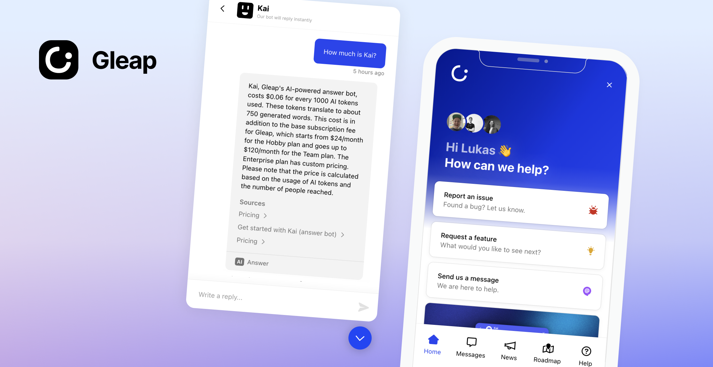

# Gleap JavaScript and TypeScript SDK



Add AI-native customer support, live chat, in-app bug reporting, a help center and surveys to websites and web apps using JavaScript or TypeScript with [Gleap](https://www.gleap.ai). Gleap is an Intercom alternative for software teams that connects customer conversations and feedback with product development.

[SDK documentation](https://docs.gleap.ai/documentation/javascript/README) · [Website](https://www.gleap.ai) · [Plans and pricing](https://www.gleap.ai/pricing)

## 📖 Docs & Examples

Checkout our [documentation](https://docs.gleap.ai/documentation/javascript/README) for full reference.

## 🚀 Getting started

1.) Create a Gleap account and project. See the [current plans and trial terms](https://www.gleap.ai/pricing).

2.) Include the Gleap JS SDK within your apps.

### Installation via npm

Install the **Gleap** package via npm or yarn.
```
npm install gleap --save
```

Import the **Gleap** package.
```
import Gleap from 'gleap';
```

**TypeScript projects:** the package types the `<gleap-*>` elements for both React 18 and React 19. This requires `@types/react` 18.2.6 or newer (17.0.51+ / 16.14.41+ on older React lines). If you see errors like `Type '"span"' is not assignable to type 'ElementType'` after installing, run `npm i -D @types/react@latest`.

### Initialize the SDK

Add the following code to initialize the Gleap JavaScript SDK. Replace "SDK-TOKEN" with your actual SDK token from the [Gleap dashboard](https://app.gleap.io).

```
Gleap.initialize("SDK-TOKEN");
```

### Data region (optional)

Projects hosted in the US data region select it before initializing. The default region is `eu`. See [docs/custom-widget-domains.md](docs/custom-widget-domains.md) for the host table and custom domains.

```
Gleap.setRegion("us");
Gleap.initialize("SDK-TOKEN");
```

### Identify your users

#### Signed identity (recommended)

Your backend signs an HS256 JWT with an identity key from Settings > Security > Identity keys (put the key id in the `kid` header; the secret stays on your server). `userId` is required. Optional claims: `email`, `name`, `company` (`{ id, name }`), `plan`, and provider ids such as `stripeCustomerId`. Set `exp` to at most one hour. The token is the whole identify: every claim lands on the contact as signed data that the browser cannot change. Call `Gleap.setUserJwt(token)` after login and on every page load of a logged-in user. See [Customer identity](https://docs.gleap.ai/documentation/guides/customer-identity).

```
// Your backend (Node, jsonwebtoken). Use an identity key from Settings > Security > Identity keys.
const token = jwt.sign(
  { userId, email, stripeCustomerId, exp: Math.floor(Date.now() / 1000) + 60 * 60 },
  SECRET,
  { algorithm: 'HS256', keyid: KEY_ID }
);
```

```
// Your app
Gleap.setUserJwt(token);
```

The token is kept in memory only. To renew it when it expires, and to sign the session again after a page reload when the grant cookie is missing, give the SDK a function that fetches a fresh one from your backend:

```
Gleap.setUserJwtProvider(() => fetch('/api/gleap-token').then((res) => res.text()));
```

Per-user tokens for your API tools (used as `{{session.authTokens.<name>}}`) are stored on the signed contact; `null` removes one:

```
Gleap.setAuthTokens({ backend: userAccessToken });
```

A valid token signs the session: the server answers with a grant that the SDK sends as the `Gleap-Grant` header on every request and hands to the messenger. It is kept in memory and in the `gleap-grant-<SDK-TOKEN>` cookie on your top-level domain (unless `Gleap.setUseCookies(false)`; on an IP address such as `127.0.0.1` it is a host-only cookie), so a page reload and a help center on a subdomain stay signed until it expires. The project's session max age (Settings > Security, 7 days by default) sets its lifetime; shorten it per app with `sessionDuration` in milliseconds:

```
Gleap.initialize("SDK-TOKEN", { sessionDuration: 24 * 60 * 60 * 1000 });
```

or later with `Gleap.setSessionDuration(24 * 60 * 60 * 1000)` (the same call as in the mobile SDKs).

`Gleap.setUserJwt` never rejects: a refused token (`token_expired`, `token_invalid`, `signature_required`) or a network error is logged to the console.

`Gleap.getIdentity()` returns `{ gleapId, gleapHash, grant, ... }` for handing the signed session to your own help center or portal. A token for another user than the current session's makes the SDK start a fresh session and identify again (the server merges it into the right contact).

`Gleap.clearIdentity()` on logout clears the contact, the token, the grant (and its cookie) and the auth tokens. The JWT provider stays set.

#### Legacy user hash

Instead of a token you can still call `Gleap.identify(userId, data, userHash)`, with `userHash` the HMAC-SHA256 of the user id created on your server with the project's identity verification secret. It is accepted while "Accept legacy user hash" is on for the project.

### Dark mode (optional)

The widget can match your app's dark/light mode. Enable "Adapt to dark / light mode" in the dashboard (Widget → Look & feel) and set the dark colors there: header colors, UI color and background. In dark mode the widget uses these dark colors, plus the dark logo, header image and composer glow set in the dashboard; without dark colors it keeps its normal colors. Override the scheme at runtime, e.g. from your own theme toggle (only takes effect while "Adapt to dark / light mode" is enabled in the dashboard; until you call it, the dashboard setting applies):

```
Gleap.setColorScheme("auto"); // follows your app; or "light" / "dark" to force a mode
```

Congrats, you are now all set! Report your first bug by using the feedback button.

## 🤝 Need help?

We are here to help! hello@gleap.io

## Releasing

1. Set `version` in `package.json` and add a `## X.Y.Z` section to `CHANGELOG.md`.
2. Merge to `master`. Cloudflare Workers Builds deploys the CDN build (`sdk.gleap.io`) on every push to `master`.
3. `git tag X.Y.Z && git push origin X.Y.Z` (plain version, no `v`).

The `Release` workflow checks that the tag matches `package.json`, runs the tests, publishes `gleap` to npm with trusted publishing (GitHub OIDC, no token; prerelease tags go to the `next` dist-tag) and creates the GitHub release from the CHANGELOG section. One-time setup: `npm trust github gleap --repo GleapSDK/JavaScript-SDK --file release.yml --allow-publish`.
